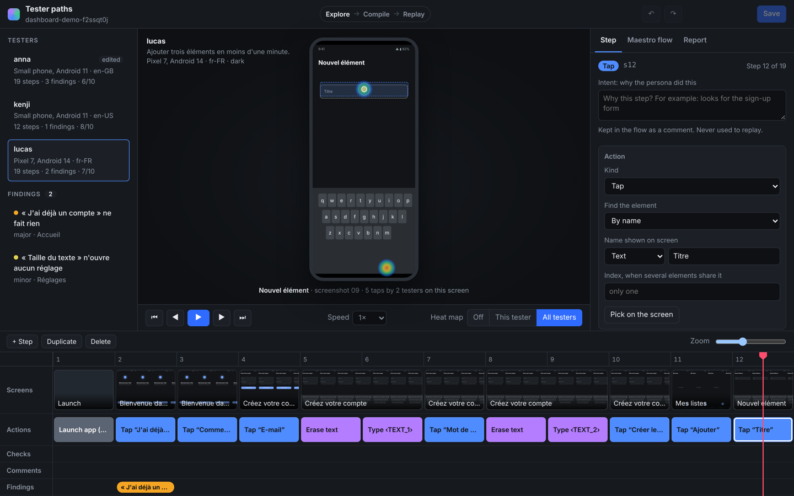

# Watch and edit the paths of the testers (experimental)

Each Android tester leaves its path in `trace.json` ([docs/replay.md](replay.md)). The dashboard shows these paths on your machine, step by step, and lets you edit them before they become tests.



```bash
bash scripts/collect.sh <run id>                 # decrypts the results into runs/<run id>/
python3 scripts/dashboard.py runs/<run id>       # opens http://127.0.0.1:8765
python3 scripts/dashboard.py --demo              # a made-up run, to try it
```

Python 3.9 or later, nothing to install. The page runs in your browser and the results never leave your machine: the server listens on `127.0.0.1` only and never serves `trace.params.json`, the texts the agent typed.

## What it shows

- **The timeline**, one column per step, like a video editor: the screens the tester went through, the actions, the checks, the comments and the findings of the report on the screens where they were seen. Play it (Space), step through it (arrows), drag the red playhead.
- **The screen before each step**, with where the finger landed and the element that was under it. A swipe is an arrow.
- **A heat map of the taps**, for this tester or for all of them. Screenshots of the same screen are grouped, even across languages (by the ids of their elements), so the map adds up every tester who went through it.
- **The Maestro flow** the path compiles to, with the lines of the selected step highlighted.
- The tester's report and findings.

## What you can edit

- Reorder steps by dragging them, delete, duplicate, or add one. A new step picks its target on the screen.
- Change how a step finds its element: by name, by id, or as a last resort by position. "Pick on the screen" fills it from the saved screen tree.
- Write the intent of a step. It goes into the flow as a comment.
- Add checks after a step: what must be visible, or not. Mark a check "Is a bug" when it was false during the run: the flow fails until the bug is fixed, then the check stays as a guard. A comment can become such a check in one click ("Make a test").
- Comment any step, or the whole path. Comments go to `trace.notes.json`, next to the trace.

Undo and redo with Ctrl+Z and Ctrl+Shift+Z, save with Ctrl+S. Saving writes `trace.json` back, still a valid trace, and keeps the explored one as `trace.explored.json` the first time. Step ids never change, so comments and the flow's source map still point to the right step.

## With Explore-Compile-Replay

The flow shown in the page is compiled the same way as [Explore-Compile-Replay](https://github.com/pierridotite/explore-compile-replay) does. To check each save and compile with the real command (Node 22.18 or later):

```bash
git clone https://github.com/pierridotite/explore-compile-replay ../explore-compile-replay
(cd ../explore-compile-replay && pnpm install)
python3 scripts/dashboard.py runs/<run id> --ecr ../explore-compile-replay
```

A save is then refused if ECR finds the trace invalid, and "Compile with ECR" in the Maestro flow tab compares ECR's flow with the preview.

## Limits

- Android only, like the traces.
- Screenshots are grouped by the ids of their elements. An app without ids (many Flutter apps) is grouped by the names of its buttons, so the same screen in two languages counts as two.
- The page has been tried on the demo run and on traces written by the offline tests. Not yet on a run on a real emulator.
